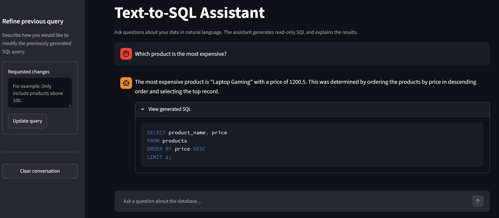
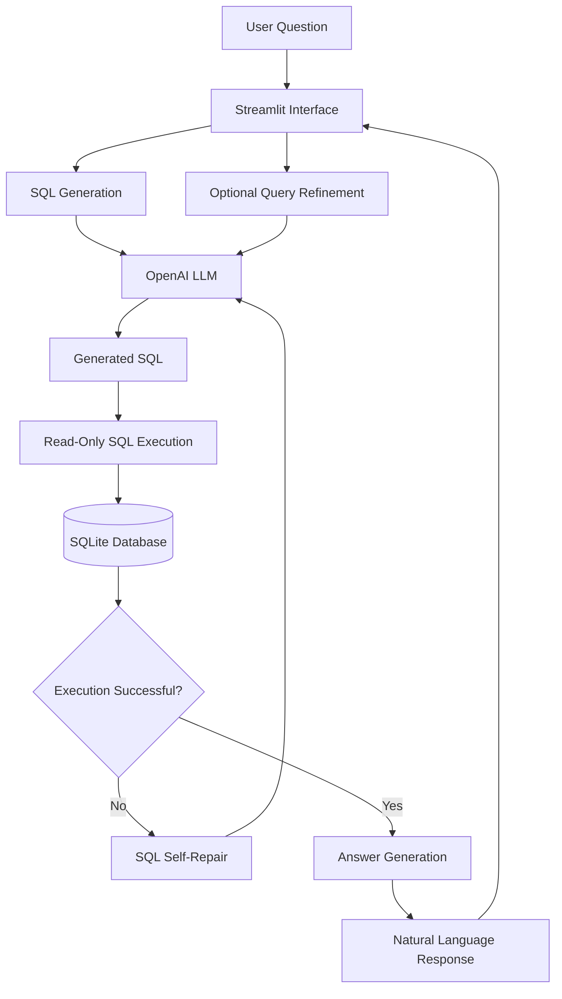

# Text-to-SQL Assistant

An AI-powered application that translates natural language questions into SQL queries, executes them against a relational database, and presents the results in a conversational interface.

Built with **Python, LangChain, OpenAI, SQLAlchemy, SQLite, and Streamlit**.

The application features automatic SQL error recovery, interactive query refinement, read-only database access, and support for Romanian and English questions.

## Overview

Text-to-SQL Assistant was originally developed as a university database course project and subsequently improved with a modular architecture, safer database execution, automated tests, and a redesigned user interface.

The goal is to make relational databases more accessible by allowing users to retrieve information without writing SQL manually.

Rather than simply generating SQL, the application implements a multi-step workflow that includes query generation, execution, error detection, automatic correction, and natural language answer generation.

## Application Preview



## Key Features

### Natural Language to SQL

Users can ask questions about the database in plain English or Romanian.

The system uses the database schema and an OpenAI language model to generate SQLite-compatible SQL queries.

### Automatic SQL Self-Repair

When a generated query fails during execution, the application captures the database error and sends it back to the LLM along with the original query and database schema.

The model attempts to generate a corrected query, with a maximum of three execution attempts.

This mechanism handles execution errors but does not guarantee that every logically incorrect query will be detected.

### Interactive Query Refinement

Users can modify the most recently generated query without starting a new conversation.

Through the **Refine previous query** interface, users can provide additional instructions, such as:

> Only include products with a price greater than 100.

The application uses the original question, previous SQL query, and requested changes to generate and execute an updated query.

### Read-Only Database Execution

Database connections are configured in SQLite read-only mode.

The application also uses `PRAGMA query_only = ON` and performs basic SQL validation before execution.

This prevents the application from modifying the demonstration database through generated SQL queries.

### Conversational Interface

The Streamlit application provides:

- A chat-based interface for natural language questions.
- Suggested questions for exploring the database.
- Access to the SQL generated for each answer.
- A query refinement form.
- Conversation history within the current session.
- A conversation reset option.
- User-friendly API error messages.

## Technology Stack

| Technology | Purpose |
|---|---|
| Python 3.11 | Application logic |
| Streamlit | Web interface and session management |
| LangChain | LLM prompt orchestration and output parsing |
| OpenAI API | SQL generation, correction, and answer generation |
| SQLAlchemy | Database connectivity and query execution |
| SQLite | Relational database |
| python-dotenv | Environment configuration |
| pytest | Automated testing |

The default OpenAI model is `gpt-4.1-mini`, configurable through an environment variable.

## System Architecture

The application separates the user interface, LLM orchestration, and database access into independent components.



### Processing Workflow

1. **User input:** The user submits a natural language question through Streamlit.
2. **Schema retrieval:** The application retrieves the available SQLite table definitions.
3. **SQL generation:** LangChain sends the question and schema to the OpenAI model.
4. **SQL execution:** The generated query is executed using a read-only database connection.
5. **Error recovery:** If execution fails, the error is provided to the LLM for automatic query correction.
6. **Answer generation:** The LLM formulates a natural language response using the executed SQL query and its result.
7. **Query refinement:** The user can optionally request changes to the most recently generated query.

## Database Schema

The application is **schema-independent**, dynamically retrieving table structures rather than relying on hardcoded schemas. This allows it to work with different SQLite databases without modifying the core Text-to-SQL logic.

For demonstration purposes, the project includes a sample **e-commerce database** with the following tables:

| Table | Description | Main Columns |
|---|---|---|
| `users` | Customer information | `id`, `name`, `email`, `signup_date` |
| `products` | Product inventory | `id`, `product_name`, `price`, `stock` |
| `orders` | Customer orders | `id`, `user_id`, `order_date`, `total_amount` |

The `orders.user_id` column references `users.id`.

The sample database is automatically generated and populated using `create_test_db.py`.

## Example Usage

**Question:**

> Which product is the most expensive?

**Example generated SQL:**

```sql
SELECT product_name, price
FROM products
ORDER BY price DESC
LIMIT 1;
```

**Expected result with the sample dataset:**

> The most expensive product is Laptop Gaming, priced at 1200.50.

The application also supports more complex questions involving filtering, aggregation, ordering, and joins.

For example:

```text
Show all products and their prices.

What is the total amount spent by each user?

Which users have placed orders?

Show products with a price greater than 100.

How many orders has each user placed?
```

The generated SQL can be inspected directly in the interface.

## Getting Started

### Setup

Before running the application, make sure you have:

- Python 3.11 installed.
- Git installed.
- An OpenAI API key with available API access.

OpenAI API usage is billed separately from ChatGPT subscriptions.

### 1. Clone the Repository

```bash
git clone https://github.com/MihneaChiose/Text-To-Sql.git
cd Text-To-Sql
```

### 2. Create a Virtual Environment

**Windows (PowerShell):**

```powershell
py -3.11 -m venv .venv
.\.venv\Scripts\Activate.ps1
```

**macOS / Linux:**

```bash
python3.11 -m venv .venv
source .venv/bin/activate
```

### 3. Install Dependencies

```bash
python -m pip install --upgrade pip
python -m pip install -r requirements.txt
```

### 4. Configure Environment Variables

Create a `.env` file in the project root.

You can copy the provided `.env.example` file.

**Windows (PowerShell):**

```powershell
Copy-Item .env.example .env
```

**macOS / Linux:**

```bash
cp .env.example .env
```

Configure the following variables:

```dotenv
OPENAI_API_KEY=your_openai_api_key
OPENAI_MODEL=gpt-4.1-mini
```

Replace `your_openai_api_key` with a valid OpenAI API key.

The `.env` file is excluded from Git and must not be committed.

### 5. Connect Your Database

The application is designed to work with **your own SQLite database**, independently of the sample database used during development. It dynamically retrieves the connected database's schema, allowing SQL queries to be generated based on its tables and relationships.

To use your own database, place it at `data/test_db.sqlite` or update `DB_PATH` in `database.py` to point to your database file.

For **development, testing, and demonstration purposes only**, the project includes `create_test_db.py`, which generates and populates a small sample e-commerce database.

To initialize this optional sample database, run:

`python create_test_db.py`

**You do not need to run this script when connecting your own database.**

### 6. Run the Application

Start the Streamlit application:

```bash
python -m streamlit run app.py
```

Open the local URL displayed in your terminal, normally:

```text
http://localhost:8501
```

You can now ask questions about the sample database in English or Romanian.

## Automated Testing

The project uses `pytest` for automated testing.

Tests cover:

- Database schema retrieval.
- SQL query execution.
- Read-only database restrictions.
- SQL error handling.
- Query result truncation.
- Initial SQL generation.
- Automatic SQL self-repair.
- Query refinement.
- Retry limits.
- Romanian and English language detection.
- Response language configuration.

LLM-dependent tests use mocked responses instead of making real OpenAI API calls.

### Install Development Dependencies

```bash
python -m pip install -r requirements-dev.txt
```

### Run the Test Suite

Initialize the sample database first:

```bash
python create_test_db.py
```

Then execute:

```bash
python -m pytest -v
```

The automated tests validate the application's logic and database operations. They do not measure the real LLM's SQL generation accuracy.

## Project Structure

```text
Text-To-Sql/
|
|-- app.py
|   Streamlit interface and session state
|
|-- robust_sql_chain.py
|   SQL generation, self-repair, query refinement,
|   language detection and answer generation
|
|-- database.py
|   Read-only SQLite access and schema retrieval
|
|-- create_test_db.py
|   Sample database creation and initialization
|
|-- tests/
|   |-- test_database.py
|   |-- test_language.py
|   |-- test_sql_chain.py
|
|-- requirements.txt
|   Application dependencies
|
|-- requirements-dev.txt
|   Development and testing dependencies
|
|-- .env.example
|   Example environment configuration
|
|-- .gitignore
|
|-- README.md
```

The `data/` directory and SQLite database are created locally during initialization.

## Design Decisions

### Separation of Concerns

The application is divided into three main components:

- **Frontend:** Streamlit manages user interaction and conversation state.
- **LLM layer:** LangChain manages prompt construction, SQL generation, correction, and answer generation.
- **Database layer:** SQLAlchemy provides isolated, read-only access to SQLite.

This design makes individual components easier to maintain and test.

### Error-Driven SQL Correction

Instead of immediately rejecting SQL queries that produce execution errors, the application attempts to repair them using the database error message.

The correction mechanism has a bounded number of attempts to prevent unlimited retry loops.

### Query Refinement

Query refinement is based on the previous SQL statement and the user's requested changes.

This enables an interactive workflow without retraining or fine-tuning the language model.

### Testability

External LLM calls are mocked in automated tests to make testing deterministic and avoid unnecessary API costs.

Database operations are tested against a locally generated SQLite database.

## Limitations

This project is intended as an educational and portfolio demonstration, not a production-ready database assistant.

Current limitations include:

- SQL generation accuracy depends on the selected language model.
- The self-repair mechanism targets SQL execution errors and cannot guarantee semantic correctness.
- The sample database contains a limited number of tables and records.
- Language detection uses heuristic word matching.
- Query refinement is maintained within the active session and is not persistent across sessions.
- Query results passed to the LLM are limited to 100 rows.
- Read-only connections prevent database modifications but do not provide comprehensive protection against resource-intensive queries or unauthorized data disclosure.
- The application requires OpenAI API access and an internet connection.

## Future Improvements

Potential future extensions include:

- Evaluating SQL generation accuracy against a benchmark of natural language questions.
- Adding structured output validation for generated SQL.
- Implementing query execution timeouts and additional resource limits.
- Supporting larger and more complex database schemas.
- Introducing retrieval-augmented schema selection for larger databases.
- Adding continuous integration for automated testing.
- Providing a containerized deployment option.

These are potential extensions and are not part of the current implementation.

## Author

**Mihnea-Stefan Chiose**

Originally developed for the university course **Databases: From NoSQL to Vector Databases** and subsequently enhanced as a software engineering portfolio project.

GitHub: [MihneaChiose](https://github.com/MihneaChiose)
